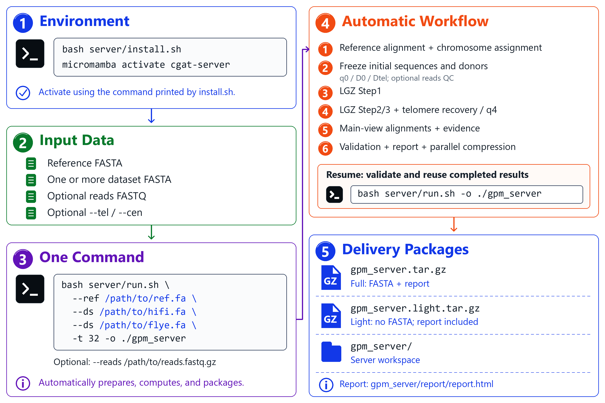

# GPM2.0

**English** | [中文](README_zh.md)

The automated assembly-repair engine is **LGZ** (**Linking Inter-assembly Units for Genome Zipping**).

GPM2.0 combines reference-anchored results from multiple de novo assemblies in one workflow for import, inspection, lightweight editing, and Final Path export.

## Architecture

| Component | Platform | Role |
| --- | --- | --- |
| **GPM2.0 Server** | Linux | Runs reference alignment, chromosome assignment, LGZ automated repair, and HTML reporting, then builds Full and Light delivery archives. |
| **GPM2.0 Desktop** | Windows / macOS | Imports a delivery archive and provides chromosome **Preview**, **Assembly** & **Subview** collinearity inspection, **Final Path** editing, `DEGAP-JOBS` generation, and export. |

Installers for `win-x86`, `win-arm64`, `mac-x86`, and `mac-arm64` are available on [CGAT Downloads](https://riceome.hzau.edu.cn/cgat/downloads) (direct mirror) and [GitHub Releases](https://github.com/Jianwei-Zhang/CGAT/releases). Development and release checks are documented in [Quality gates](QUALITY.md).

## Server Workflow



### 1. Download the tools and create the environment

On your Linux server, download the Server tools (source package) from [Release v2.0.16](https://github.com/Jianwei-Zhang/CGAT/releases/tag/v2.0.16), or the [official docs](https://riceome.hzau.edu.cn/cgat/downloads), then verify, extract into the default or custom directory, and install:

New installations default to `~/bin/GPM_Server`; existing installations keep their actual paths. The subshell below does not change your working directory, so project outputs stay outside the tools directory. Without AI, use the commands below; the [Server README](server/README.md#installation-prompt-for-your-ai-agent) also provides an agent installation prompt.

```bash
SERVER="$HOME/bin/GPM_Server"  # Custom paths are supported; do not overwrite an existing installation
(
  set -euo pipefail
  mkdir -p "$(dirname "$SERVER")"
  mkdir "$SERVER"
  cd "$SERVER"
  archive=GPM_Server_2.0.16_source.tar.gz
  curl -fL --connect-timeout 8 --max-time 60 -o "$archive" \
    "https://riceome.hzau.edu.cn/cgat/downloads/v2.0.16/$archive" ||
    curl -fL --connect-timeout 8 --max-time 60 -o "$archive" \
      "https://github.com/Jianwei-Zhang/CGAT/releases/download/v2.0.16/$archive"
  curl -fL --connect-timeout 8 --max-time 30 -o SHA256SUMS \
    https://riceome.hzau.edu.cn/cgat/downloads/v2.0.16/SHA256SUMS ||
    curl -fL --connect-timeout 8 --max-time 30 \
      https://api.github.com/repos/Jianwei-Zhang/CGAT/releases/tags/v2.0.16 |
      python3 -c 'import json,sys; r=json.load(sys.stdin); print("\n".join(a["digest"].removeprefix("sha256:")+"  "+a["name"] for a in r["assets"] if a["name"].endswith("_source.tar.gz")))' > SHA256SUMS
  grep "  $archive$" SHA256SUMS | sha256sum -c -
  tar -xzf "$archive" --strip-components=1
  bash ./install.sh
)
```

The script reuses `mamba`, `micromamba`, or `conda`. If none is available, it installs micromamba for the current user without `sudo`. Use `--manager conda|mamba|micromamba` to select one explicitly. After the installer prints `GPM Server installation: READY`, activate the environment with the command it provides, for example:

```bash
micromamba activate cgat-server
```

Check the installation later without changing it:

```bash
bash "$SERVER/install.sh" --check
```

Re-running `install.sh` validates the managed environment and updates it only when the dependency specification changes. The previous `env.sh` entry remains compatible. `SERVER` records the actual tools path. Run analysis from your project directory, not inside `~/bin/`. For a repository checkout, set `SERVER` to the absolute `GPM2.0/server/` path. See the [server quick start](server/README.md) for details.

| Purpose | Commands installed or required |
| --- | --- |
| Core workflow | `python3`, `samtools`, `zip`, `gzip` |
| LGZ Final Path | `minimap2`, `nucmer`, `delta-filter`, `show-coords` |
| Optional reads QC | `meryl`, `merqury.sh`; used only when `--reads` is supplied |

Keep this environment active for `run.sh`.

#### Update tools, skill, and the current project runtime

Run the same entrypoint from the project directory or a child directory (use the actual path for custom installations):

```bash
bash ~/bin/GPM_Server/update.sh
```

This entrypoint requires a source package containing `update.sh`. If an older package lacks it, follow the Server/skill one-time adoption instructions rather than overwriting the installation.

Checks and downloads use the [official docs](https://riceome.hzau.edu.cn/cgat/downloads) first, falling back to GitHub Release on failure.
Tools and skill come from the same release bundle. If everything matches, it reports
already up to date; otherwise it lists changes, backs up originals, and updates
without a Y/N prompt, including with closed stdin. There are no extra flags.
An older installed updater may still prompt once while upgrading itself.
New `run.sh` and generated `run_all.sh` check updates before analysis; a stopped
prepared runtime can also be synchronized from verified local tools while offline.
Inside a project it also aligns `.prepare_lib/`; outside a project it does not scan other projects.
Preserves skill `local/`, actual paths, logs, results, caches, and the environment; never starts analysis.
Stop all affected jobs, including other nodes, before updating. Backups support rollback.
For a Step2 `missing its output gap interval` failure, update both tools and the affected workspace runtime before resuming; preserve logs, results, and raw-alignment caches.
See [Server update details](server/README.md#update-tools-skill-and-project-runtime) for legacy adoption and limits.

### 2. Run the full workflow

Minimal example with an explicit output directory:

```bash
bash "$SERVER/run.sh" \
  --ref /path/to/rice_IRGSP_1_0.fa \
  --ds /path/to/hifiasm.fa \
  --ds /path/to/flye.fa \
  --ds /path/to/canu2.fa \
  -o ./gpm_server \
  -t 10
```

`--ref` and `--ds` accept either `<name> <fasta>` or just `<fasta>`. When the name is omitted, it is inferred from the FASTA filename: `.gz` and one `.fa`, `.fasta`, or `.fna` suffix are removed case-insensitively, and runs outside letters, numbers, dot, underscore, and hyphen are replaced with `_`. For example, `/data/primary assembly.fa.gz` becomes `primary_assembly`. Use the explicit form whenever a different name is required.

When preparing the workspace, the first `--ds` becomes the primary dataset and the remaining entries become auxiliary datasets; these roles remain fixed throughout LGZ processing. Plain or gzip-compressed `.fa`, `.fasta`, and `.fna` inputs are accepted. The generated `add_dataset.sh` supports the same optional-name `--ds` forms.

#### Common options

| Option | Required / default | Description |
| --- | --- | --- |
| `--ref [<name>] <fasta>` | Required once | Reference FASTA; omit the name to infer it from the filename. |
| `--ds [<name>] <fasta>` | Required, repeatable | Initial assembly dataset; omit the name to infer it from the filename. The first is primary; the rest are auxiliary datasets. |
| `-o, --out <dir>` | `./gpm_server` | Server workspace and generated scripts. |
| `-s, --score <0-100>` | `60` | Minimum chromosome-assignment coverage percentage. |
| `-t, --threads <n>` | `10` | Total compute-thread budget shared by independent alignment tasks and reads-QC jobs. |
| `--skip-self` | Off | Skip same-dataset self alignment; same-dataset Subview becomes unavailable. |
| `--tel <motif> <count>` | Optional, repeatable | Mark exact telomere-like repeats on both strands. Example: `--tel TTAGGG 20`. |
| `--cen <fasta>` | Optional | Reference centromere FASTA. Record names must end in `_centromere`, such as `Chr01_centromere`. |
| `--cen-min-len <bp>` | `10000` | Minimum centromere alignment length. |
| `--cen-min-identity <pct>` | `80` | Minimum centromere alignment identity percentage. |
| `--reads <fastq>` | Optional, repeatable | Enable shared Meryl data plus per-dataset Merqury QV assessment; the `--threads` budget is distributed across datasets. |
| `--grt-qc-memory-gb <n>` | `80` | Memory limit for optional reads QC. |
| `--grt-kmer-size <n>` | `21` | K-mer size for optional reads QC. |
| `--max-fill <bp>` | `1000000` | Length limit for both Step3 optimized refill rounds; can be changed on resume. |

#### Aligner-specific options

| Aligner | Option | Allowed values / default |
| --- | --- | --- |
| `minimap2` | `--minimap-preset` | `asm10` or `asm5`; default `asm10` |

GPM Server always uses Minimap2. BLASTN and Winnowmap are not available because whole-genome runs could not meet the workflow's runtime and memory requirements. LGZ processing resolves `minimap2` and the MUMmer4 commands from `PATH`.

### 3. Resume and monitor

```bash
bash "$SERVER/run.sh" -o ./gpm_server
```

The runner executes the generated plan serially, stops at the first error, validates checkpoints before reuse, and creates both archives beside `gpm_server/`:

| Archive | Contents and use |
| --- | --- |
| `gpm_server.tar.gz` | Full App package with source/reference FASTA, authoritative q4 FASTA, and the complete `report/` directory. Supports client-side FASTA export. |
| `gpm_server.light.tar.gz` | Light App package with FASTA omitted; retains `.fai`, metadata, Final Path, source-card state, PAF views, and the complete `report/` directory. Supports import, inspection, and PNG/TSV export. |

The default is parallel `tar.gz` compression with pigz. Use `--archive-format zip` for ZIP; the App accepts both formats.

These two archives are the only final delivery files. A separate report ZIP is not created. Open `gpm_server/report/report.html` in the Server workspace or inside either extracted delivery package. Recording starts during input preparation; `run_all.sh` updates the report at stage boundaries, including failures, interruptions, and unexecuted stages. First-published LGZ events are preserved separately from their reconciled final state, and cache reuse is explicit. Previous reports are archived under the workspace's `.report_history/` directory.

To avoid a checksum referring to the archive that contains it, the report records the App payload checksum before `report/` is embedded. After both final archives are complete, `run_all.sh` prints their final paths, sizes, SHA-256 values, intended uses, and the local report path; the same summary is written to `logs/run_all.log`.

After copying or extracting the entire `report/` directory, regenerate without access to the original workspace or network:

```bash
python3 /path/to/report/render_report.py
```

The renderer reads only report-local records and does not rerun alignments or repairs. Reports contain no raw FASTA/reads; unmeasured quality metrics remain unavailable. Gap counts use consecutive runs of at least 100 Ns; explicit connector segments and total N bases are recorded separately. Automatic reporting currently covers `prepare.sh` and `run_all.sh`; standalone incremental or packaging commands do not update an earlier run's report. See [report format and scope](server/REPORT.md).

The first `run.sh` invocation prepares and runs the full workflow automatically. Resume with the same command or just `-o`. The existing `prepare.sh` and generated `run_all.sh` remain compatible. The prepared thread count remains fixed; runtime `--threads`, `--from`, `--until`, and `--stage` overrides are not supported.

```bash
tail -F ./gpm_server/logs/progress.log
```

The runner now prints compact progress by default; `logs/progress.log` contains the
same plain-text view. `logs/run_all.log` retains full diagnostics. Terminal colors
are automatic only on interactive outputs, so Slurm logs stay plain. Use the
read-only viewer for colored monitoring, or add `--detailed` for the full log:

```bash
python3 "$SERVER/tools/view_run_log.py" --server-dir ./gpm_server --follow
```

`report/report.html` still receives original events and diagnostic output, not the
filtered display. See [logging controls and compatibility](server/README.md#progress-logs-and-terminal-colors).
Do not update a running job's tools or embedded runtime.

Current unit states are written to `gpm_server/logs/status.tsv`. Only one runner may own a workspace at a time.

### 4. Add data and re-package

Append one dataset and create an add package for an existing desktop workspace/project:

```bash
bash ./gpm_server/add_dataset.sh \
  --ds ds4_name /path/to/ds4.fa \
  -o ./gpm_server/add_ds4_name.zip
```

The new dataset is merged into the server workspace but is not included in the completed LGZ processing and does not rewrite the precomputed Final Path. Its contigs remain available for manual editing in the App.

The initial `run_all.sh` already builds both delivery archives. Re-run the standalone packagers only after later changes such as `add_dataset.sh` or `add_ctg.sh`:

```bash
bash ./gpm_server/package_full_zip.sh
bash ./gpm_server/package_light_zip.sh
```

Use a rebuilt full package for a new desktop workspace or a complete re-import. Add packages are only for an existing workspace/project.

## Desktop App

### Install and import

Download the installer for the client architecture from [GitHub Releases](https://github.com/Jianwei-Zhang/CGAT/releases), then import either delivery archive.

The macOS app is ad-hoc signed and is not Apple-notarized. Drag `GPM2.0.app` to `/Applications` before opening it. If macOS blocks the first launch, open **System Settings -> Privacy & Security** and choose **Open Anyway**. If that control is unavailable, run the following command only for an app downloaded from this project's official GitHub Release:

```bash
xattr -dr com.apple.quarantine /Applications/GPM2.0.app
```

The package preserves the primary and auxiliary dataset roles established during LGZ processing and loads the Server-precomputed Final Path. Project-level paths remain editable and can continue into DEGAP or export.

### Core desktop workflow

| Workspace View | Purpose |
| --- | --- |
| **1. Project & Datasets** | Import Full/Light archives or `test_data.zip`, manage local workspaces, and inspect per-dataset sequence counts, total lengths, N50, and N90. |
| **2. Preview** | Inspect chromosome-level Final Path source contributions and remaining gaps at a glance before entering a chromosome workspace. |
| **3. Assembly & Subview** | Examine chromosome-wide collinearity ribbons, filter alignments, manipulate contig cards, and zoom in on local pairwise evidence in Subview. |
| **4. Final Path & Export** | Reorder, flip, or insert contig slices and gaps (with per-chromosome baseline restore), export `DEGAP-JOBS`, or export PNG, TSV, LOG, and FASTA files. |

### In-app updates (updater-enabled builds)

This feature is being implemented; it has not been released as part of this change. The following workflow applies to a signed, updater-enabled build. Users of older builds without an updater must manually install the first updater-enabled version once.

- Open **App settings → App updates** at the bottom of the settings panel to see the current version and **Check for updates**. The App will also check in the background and notify you when a newer version is available.
- Update metadata, release notes and packages use the **docs download source first**, falling back to **GitHub Releases** on failure. A valid but not-yet-synchronized docs manifest does not trigger an additional GitHub check.
- The update dialog follows the App's current language, theme and typography. It loads release notes only for the selected language. **Do not remind me for 24 hours** suppresses automatic reminders across restarts; manual checks remain available.
- Choose **Download update**, then **Install and restart** inside the App. There is no need to open a download webpage or locate and launch an installer manually; the operating system may still request installation permission.
- Installation requires a verified update package and successful project-state saving. Wait for active tasks to finish; a failed save stops installation. This updates only the desktop App, not remote Server tools or workspaces.

### Project dataset tables

The project page summarizes sequence count, total length, N50, and N90 for the reference, primary, auxiliary, and derived datasets. Statistics include all sequences without splitting at Ns and are unaffected by moving or hiding contigs in assembly views. Light packages support the same statistics.

Display names and notes are editable; original identifiers, filenames, and sequence names remain unchanged.

### Export Final Path FASTA from a Light package

Export Final Path TSV from the App, copy it back to the server that retains the original FASTA files, and run:

```bash
bash "$SERVER/export_final_path_fasta.sh" \
  --tsv /path/to/project_Chr01_path.tsv \
  --gpm_server ./gpm_server \
  -o /path/to/project_Chr01_path.fa
```

The helper generated inside `gpm_server/` detects that workspace automatically:

```bash
bash ./gpm_server/export_final_path_fasta.sh \
  --tsv /path/to/project_Chr01_path.tsv \
  -o /path/to/project_Chr01_path.fa
```
