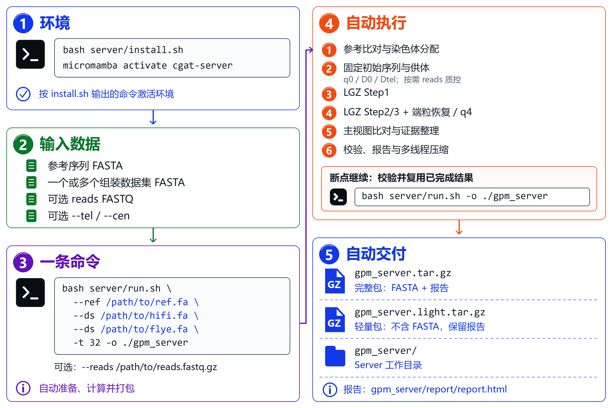

# GPM2.0

**中文** | [English](README.md)

GPM2.0 将多种 de novo 组装结果统一到以参考基因组为锚点的流程中，用于导入、浏览、轻量编辑和 Final Path 导出。

## 项目架构

| 组件 | 运行平台 | 核心职责 |
| --- | --- | --- |
| **GPM2.0 服务端** | Linux | 执行参考比对、染色体分配、GRT 自动修复与报告生成，产出 Full 与 Light 交付包。 |
| **GPM2.0 桌面端** | Windows / macOS | 导入交付包，提供染色体 **Preview** 来源总览、**Assembly** 与 **Subview** 共线性检查、**Final Path** 编辑、`DEGAP-JOBS` 导出与结果导出。 |

`win-x86`、`win-arm64`、`mac-x86`、`mac-arm64` 安装包可通过 [官方文档站直连下载](https://riceome.hzau.edu.cn/cgat/zh/downloads) 或 [GitHub Releases](https://github.com/Jianwei-Zhang/CGAT/releases) 获取。开发和发布检查见[质量门禁](QUALITY_zh.md)。

## 服务端流程



### 1. 下载工具并创建环境

在 Linux 服务端执行以下命令，优先从[官网](https://riceome.hzau.edu.cn/cgat/zh/downloads)下载 Server 工具包，失败时回退 [Release v2.0.12](https://github.com/Jianwei-Zhang/CGAT/releases/tag/v2.0.12)，校验后解压安装：

新安装默认使用 `~/bin/GPM_Server`，已有安装保留原路径。以下子 shell 不会改变当前工作目录，项目结果仍写入当前工作目录。若不使用 AI，可直接按下列命令安装；AI 安装提示词见[Server README](server/README_zh.md#给-ai-agent-的安装提示词)。

```bash
SERVER="$HOME/bin/GPM_Server"  # 可改为自定义路径；已有安装不要覆盖
(
  set -euo pipefail
  mkdir -p "$(dirname "$SERVER")"
  mkdir "$SERVER"
  cd "$SERVER"
  archive=GPM_Server_2.0.12_source.tar.gz
  curl -fL --connect-timeout 8 --max-time 60 -o "$archive" \
    "https://riceome.hzau.edu.cn/cgat/downloads/v2.0.12/$archive" ||
    curl -fL --connect-timeout 8 --max-time 60 -o "$archive" \
      "https://github.com/Jianwei-Zhang/CGAT/releases/download/v2.0.12/$archive"
  curl -fL --connect-timeout 8 --max-time 30 -o SHA256SUMS \
    https://riceome.hzau.edu.cn/cgat/downloads/v2.0.12/SHA256SUMS ||
    curl -fL --connect-timeout 8 --max-time 30 \
      https://api.github.com/repos/Jianwei-Zhang/CGAT/releases/tags/v2.0.12 |
      python3 -c 'import json,sys; r=json.load(sys.stdin); print("\n".join(a["digest"].removeprefix("sha256:")+"  "+a["name"] for a in r["assets"] if a["name"].endswith("_source.tar.gz")))' > SHA256SUMS
  grep "  $archive$" SHA256SUMS | sha256sum -c -
  tar -xzf "$archive" --strip-components=1
  bash ./install.sh
)
```

脚本会复用 `mamba`、`micromamba` 或 `conda`；均不存在时，为当前用户无 sudo 安装 micromamba。也可用 `--manager conda|mamba|micromamba` 明确选择。安装结束显示 `GPM Server installation: READY` 后，按脚本打印的命令激活环境，例如：

```bash
micromamba activate cgat-server
```

随时可以只检查、不修改环境：

```bash
bash "$SERVER/install.sh" --check
```

再次运行 `install.sh` 会校验托管环境，仅在依赖配置变化时更新；原 `env.sh` 入口继续兼容。`SERVER` 保存工具的实际路径；计算命令在项目工作目录执行，避免将结果写入 `~/bin/`。使用仓库源码时，将 `SERVER` 设为 `GPM2.0/server/` 的绝对路径。更多说明见[服务端快速入门](server/README_zh.md)。

| 用途 | 安装或要求的命令 |
| --- | --- |
| 核心流程 | `python3`、`samtools`、`zip`、`gzip` |
| GRT Final Path | `minimap2`、`nucmer`、`delta-filter`、`show-coords` |
| 可选 reads 质控 | `meryl`、`merqury.sh`；仅传入 `--reads` 时使用 |

执行 `run.sh` 时保持该环境已激活。

#### 更新 Server tools、skill 与当前项目运行库

在项目目录或子目录执行同一个入口（自定义安装请使用实际路径）：

```bash
bash ~/bin/GPM_Server/update.sh
```

此入口要求工具包包含 `update.sh`；旧包缺少该脚本时不要直接覆盖安装，先按 Server/skill 更新说明完成一次性接入。

检查和下载优先使用[官网](https://riceome.hzau.edu.cn/cgat/zh/downloads)，失败时回退 GitHub Release。tools 和 skill 使用同一发布源码包。
全部最新且一致时直接告知；否则列出变更并询问 `[y/N]`，只接受 `Y/y` 确认，
`N/n`、回车或无交互终端均不更新，无需额外参数。
在项目内执行会同时对齐 `.prepare_lib/`；不在项目内则不扫描其他项目。
保留 skill `local/`、实际路径、日志、结果、缓存与依赖环境，不自动重跑分析。
更新前停止所有受影响任务（含其他节点），失败可用备份回滚。
旧安装首次接入和限制见[Server 更新说明](server/README_zh.md#更新工具skill-与项目运行库)。

### 2. 运行完整流程

显式指定输出目录的最简示例：

```bash
bash "$SERVER/run.sh" \
  --ref /path/to/rice_IRGSP_1_0.fa \
  --ds /path/to/hifiasm.fa \
  --ds /path/to/flye.fa \
  --ds /path/to/canu2.fa \
  -o ./gpm_server \
  -t 10
```

`--ref` 和 `--ds` 均支持 `<名称> <fasta>` 与仅传 `<fasta>` 两种写法。省略名称时，会从 FASTA 文件名自动推导：不区分大小写地移除 `.gz` 及一个 `.fa`、`.fasta` 或 `.fna` 后缀；名称中除字母、数字、点、下划线和连字符以外的连续字符会替换为 `_`。例如 `/data/primary assembly.fa.gz` 会得到名称 `primary_assembly`；需要其他名称时仍可使用原有显式写法。

准备工作目录时，第一个 `--ds` 作为主组装（primary dataset），其余 `--ds` 作为辅助组装（auxiliary datasets）；这些角色用于本次 GRT 计算并保持不变。支持普通或 gzip 压缩的 `.fa`、`.fasta`、`.fna` 输入。生成的 `add_dataset.sh` 同样支持名称可省略的 `--ds` 写法。

#### 通用参数

| 参数 | 必填 / 默认值 | 说明 |
| --- | --- | --- |
| `--ref [<名称>] <fasta>` | 必填，一次 | 参考基因组 FASTA；省略名称时从文件名自动推导。 |
| `--ds [<名称>] <fasta>` | 必填，可重复 | 初次输入的组装数据集；省略名称时从文件名自动推导。第一个为主组装，其余为辅助组装。 |
| `-o, --out <目录>` | `./gpm_server` | 服务端工作目录及生成脚本的位置。 |
| `-s, --score <0-100>` | `60` | 染色体分配的最小覆盖率百分比。 |
| `-t, --threads <数量>` | `10` | 总计算线程预算，在独立比对任务及 reads QC 任务之间分配。 |
| `--skip-self` | 关闭 | 跳过同 dataset 自比对；同 dataset Subview 将不可用。 |
| `--tel <motif> <次数>` | 可选，可重复 | 标记双链上的精确端粒样重复。例如 `--tel TTAGGG 20`。 |
| `--cen <fasta>` | 可选 | 参考着丝粒 FASTA；记录名必须以 `_centromere` 结尾，例如 `Chr01_centromere`。 |
| `--cen-min-len <bp>` | `10000` | 着丝粒比对最小长度。 |
| `--cen-min-identity <百分比>` | `80` | 着丝粒比对最小一致性百分比。 |
| `--reads <fastq>` | 可选，可重复 | 启用共享 Meryl 数据及逐 dataset Merqury QV 评估；`--threads` 总预算会分配给各 dataset。 |
| `--grt-qc-memory-gb <数量>` | `80` | 可选 reads 质控的内存上限。 |
| `--grt-kmer-size <数量>` | `21` | 可选 reads 质控的 k-mer 大小。 |
| `--max-fill <bp>` | `1000000` | Step3 两轮优化补洞的长度上限；恢复时可修改。 |

#### 比对引擎专属参数

| 引擎 | 参数 | 可选值 / 默认值 |
| --- | --- | --- |
| `minimap2` | `--minimap-preset` | `asm10` 或 `asm5`；默认 `asm10` |

GPM Server 固定使用 Minimap2。BLASTN 与 Winnowmap 的全基因组运行无法满足当前流程的时间和内存要求，因此不再提供这两个引擎。GRT 计算始终从 `PATH` 解析 `minimap2` 和 MUMmer4 命令。

### 3. 恢复与监控

```bash
bash "$SERVER/run.sh" -o ./gpm_server
```

该命令串行执行生成的计划，遇到首个错误即停止，复用前会重新校验 checkpoint，并在 `gpm_server/` 同级目录生成两个交付包：

| 交付包 | 内容与用途 |
| --- | --- |
| `gpm_server.tar.gz` | 完整 App 包，包含 source/reference FASTA、权威 q4 FASTA 和完整 `report/` 目录，可在客户端导出 FASTA。 |
| `gpm_server.light.tar.gz` | Light App 轻量包，不含 FASTA，保留 `.fai`、metadata、Final Path、source-card 状态、PAF 视图和完整 `report/` 目录，可导入、浏览并导出 PNG/TSV。 |

默认使用 pigz 多线程压缩为 `tar.gz`；`--archive-format zip` 可保留 ZIP 格式，App 支持两者。

这两个压缩包是仅有的最终交付文件，不再单独生成报告 ZIP。可直接打开服务端工作目录或任一解压后交付包中的 `gpm_server/report/report.html`。`prepare.sh` 从输入准备阶段开始记录，`run_all.sh` 在阶段结束时更新报告；失败或中断也保留报告及尚未执行的阶段。GRT 首次发布的阶段事件与最终协调后的状态分别保留，缓存复用明确标注。重跑前一份报告保存在工作目录的 `.report_history/` 下。

为避免校验值引用包含自身的压缩包，报告记录嵌入 `report/` 之前的 App 数据载荷校验值。两个最终压缩包完成后，`run_all.sh` 会明确打印其路径、大小、SHA-256、用途和本地报告路径；同一摘要也写入 `logs/run_all.log`。

复制或解压整个 `report/` 后，可在原工作目录不可访问、网络断开的情况下重新生成：

```bash
python3 /path/to/report/render_report.py
```

生成器只读取报告目录内的记录，不重新计算比对或修复。报告不携带原始 FASTA/reads；未测量的质量指标不显示为零。报告中的 gap 统计指连续至少 100 个 N，显式连接 gap 与 N 碱基总数分别记录。当前自动报告覆盖 `prepare.sh` 和 `run_all.sh`；单独执行增量脚本或打包脚本不会更新此前的运行报告。详见 [报告格式与边界](server/REPORT.md)。

首次 `run.sh` 会自动准备并运行完整流程；恢复时重复原命令，或仅指定 `-o`。原有 `prepare.sh` 和生成的 `run_all.sh` 仍兼容。线程数固定为准备阶段的值；不支持运行时 `--threads`、`--from`、`--until` 或 `--stage` 覆盖。

```bash
tail -F ./gpm_server/logs/progress.log
```

runner 默认输出精简进度，`logs/progress.log` 保存相同的纯文本展示，
`logs/run_all.log` 保留完整诊断。自动颜色仅用于交互输出，Slurm 日志保持纯文本。
可用只读查看器彩色监控；加 `--detailed` 切换为完整日志：

```bash
python3 "$SERVER/tools/view_run_log.py" --server-dir ./gpm_server --follow
```

`report/report.html` 继续接收原始事件及诊断输出，不使用精简后的显示内容。
详见 [日志控制与兼容说明](server/README_zh.md#进度日志与终端颜色)。
不要更新正在运行作业的工具或内嵌运行库。

当前单元状态写入 `gpm_server/logs/status.tsv`。同一工作目录同时只允许一个 runner。

### 4. 追加数据与重新打包

向已有桌面端工作区/项目追加一个 dataset：

```bash
bash ./gpm_server/add_dataset.sh \
  --ds ds4_name /path/to/ds4.fa \
  -o ./gpm_server/add_ds4_name.zip
```

新数据集会合并进服务端工作目录，但不参与已经完成的 GRT 计算，也不会改写预计算的 Final Path；其 contig 仍可在 App 中手工编辑。

初次 `run_all.sh` 已自动生成两种交付包。仅在后续执行 `add_dataset.sh`、`add_ctg.sh` 等操作后按需重新打包：

```bash
bash ./gpm_server/package_full_zip.sh
bash ./gpm_server/package_light_zip.sh
```

新建桌面端工作区或完整重新导入时使用重新生成的完整包；追加包只用于已有工作区/项目。

## 桌面端 App

### 安装与导入

从 [GitHub Releases](https://github.com/Jianwei-Zhang/CGAT/releases) 下载与客户端架构匹配的安装包，然后导入任一服务端交付包。

macOS App 使用 ad-hoc 签名，未经 Apple 公证。请先将 `GPM2.0.app` 拖入 `/Applications` 再打开。如果 macOS 阻止首次启动，请进入 **系统设置 -> 隐私与安全性** 并选择 **仍要打开**。如果该控件不可用，仅对从本项目官方 GitHub Release 下载的 App 执行：

```bash
xattr -dr com.apple.quarantine /Applications/GPM2.0.app
```

交付包保留 GRT 计算时确定的主组装与辅助组装角色，并直接载入服务端预计算的 Final Path。项目级路径仍可编辑，并可继续进入 DEGAP 或导出流程。

### 桌面端核心工作流

| 工作区模块 | 功能说明 |
| --- | --- |
| **1. 项目导入与数据集表** | 导入 Full / Light 交付包或 `test_data.zip`，管理本地工作区，汇总查看参考、主/辅组装及派生数据集的序列数、总长度、N50 与 N90。 |
| **2. Preview（来源总览）** | 全局浏览各染色体 Final Path 的来源数据集分布与剩余 Gap 位置，快速定位待复核染色体。 |
| **3. Assembly 与 Subview** | 在染色体尺度检查共线性比对色带、调整筛选条件、移动/翻转/隐藏/镜像 contig，并在 Subview 中放大核对局部成对比对与锚点证据。 |
| **4. Final Path 编辑与导出** | 编辑染色体片段顺序与方向（支持按染色体一键恢复服务端预计算基线），导出 `DEGAP-JOBS` 长读段补洞任务，或导出 PNG、TSV、日志与 FASTA。 |

### 应用内更新（已启用更新的构建）

本功能正在接入，尚未随本次改动发布。以下流程适用于已启用签名更新的构建；不含更新模块的旧版本仍需手动安装一次首个支持更新的版本。

- 在设置面板底部打开 **App 设置 → 应用更新**，查看当前版本并点击 **检查更新**。App 也会在后台检查，发现新版后弹窗提醒。
- 更新清单、更新说明和更新包均 **优先使用 docs 下载源，失败时回退 GitHub Releases**。docs 若返回有效但尚未同步的旧清单，不会额外查询 GitHub。
- 更新弹窗跟随 App 当前语言、主题和字号，只加载所选语言的更新说明。勾选 **24 小时内不再提醒** 后，重启 App 仍不自动提醒；手动检查不受影响。
- 在 App 内依次点击 **下载更新**、**安装并重启**，无需跳转下载网页，也无需手动寻找和执行安装包；系统仍可能要求安装权限确认。
- 安装前必须通过更新包校验并成功保存项目状态。正在执行的任务需先完成，保存失败会停止安装。此操作只更新桌面 App，不更新远端 Server 工具或工作目录。

### 项目数据集表格

项目页汇总参考、主组装、辅助组装及派生数据集的序列数、总长度、N50、N90。统计包含全部序列，不按 N 拆分，也不受组装视图中 contig 移动或隐藏的影响；Light 轻量包同样支持。

可编辑显示名称和备注，原始标识、文件名和序列名保持不变。

### 从 Light 轻量包导出 Final Path FASTA

先在 App 中导出 Final Path TSV，再将 TSV 放回保留原始 FASTA 的服务器：

```bash
bash "$SERVER/export_final_path_fasta.sh" \
  --tsv /path/to/project_Chr01_path.tsv \
  --gpm_server ./gpm_server \
  -o /path/to/project_Chr01_path.fa
```

`gpm_server/` 内生成的 helper 会自动识别工作目录：

```bash
bash ./gpm_server/export_final_path_fasta.sh \
  --tsv /path/to/project_Chr01_path.tsv \
  -o /path/to/project_Chr01_path.fa
```
