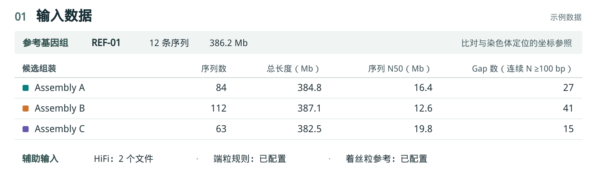
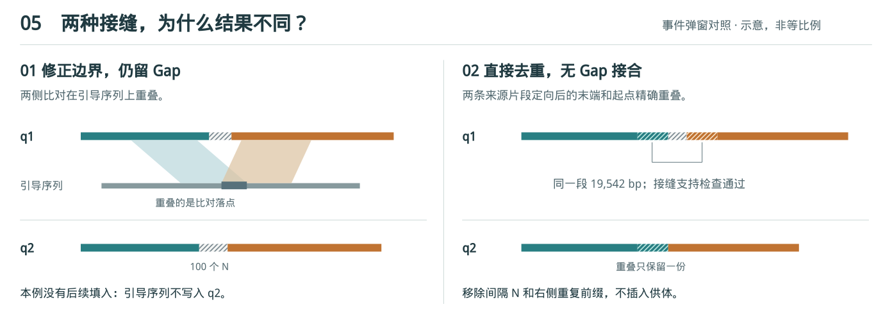
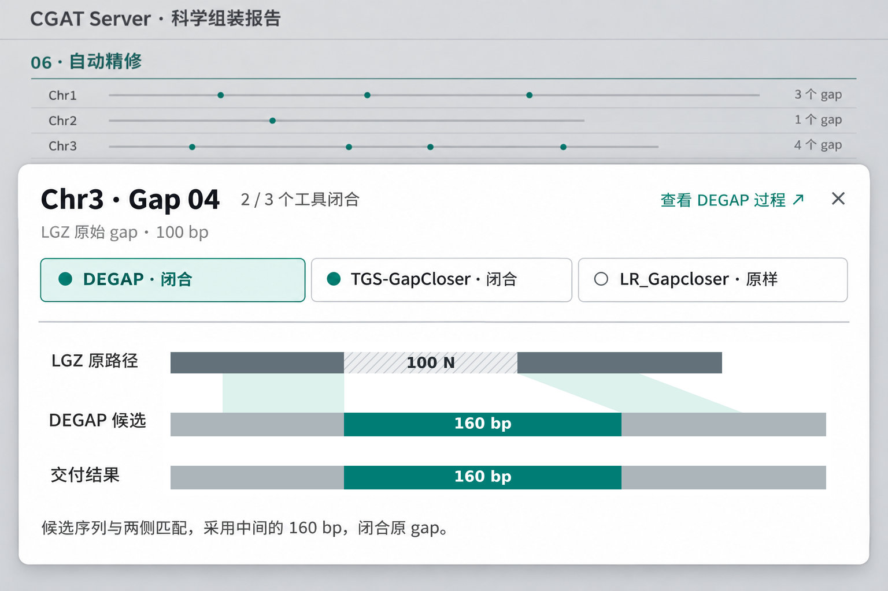
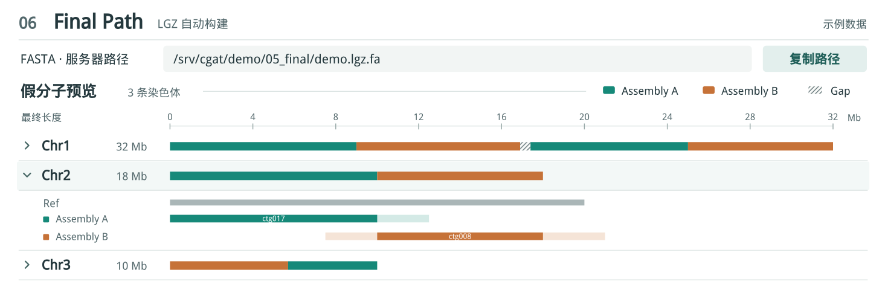

# CGAT Server 报告设计：Final Path 是怎样形成的？

**2026-11-25 定稿 · 设计与验收依据，非已上线功能说明。** 面向打开离线报告的组装者。正文让读者顺着一条染色体看：哪些输入被分到这里，q0 如何形成，后面哪一处变了、为什么变，最终交付了哪条序列。日志、候选清单和重复的汇总表不占正文。

与本文配套的 [ViewModel v1 契约](server-report-viewmodel-contract-20261124.md) 描述**当前已有**的数据、发布校验和兼容边界。下列图均为设计示例，不是实际作业、测量值或判定阈值。

## 一次作业会看到哪些卡片

| 实际发生的过程 | 正文顺序 |
| --- | --- |
| 仅运行 LGZ | 01 输入 → 02 染色体分组 → 03 初始路径 q0 → 04 第一轮修补 → 05 结构修正与再填补 → 端粒处理 → **06 Final Path（LGZ-only）** |
| 启用自动精修 | 相同 LGZ 过程，随后是 **06 自动精修 → 07 Final Path（LGZ + 所选工具）**。不在两者前再放一遍 LGZ-only 成品卡。 |
| 另有手动任务 | 在该作业已有的正文之后显示 **08 手动精修**。它不要求先运行自动精修，每批从自己的 App 导出快照开始。没有手动任务就不留空卡。 |

端粒处理是 LGZ 内独立的 `q2 → q3` 过程块，不占用自适应的 06。报告停在最后一次实际交付；不再加 09 总结或下载中心。工具失败可以解释，但未发布的结果不能充当 Final Path。

## 01–03：从输入到 q0

**01 输入。** 顶部一条参考带：参考名、FASTA 序列数、总长，以及“比对与染色体定位的坐标参照”。主体按候选组装列出来源色、FASTA 序列数、总长、序列 N50、Gap 数（每条记录中连续 N ≥100 bp 的区间数）。末行放本次实际提供的辅助输入：HiFi/ONT 文件数、端粒规则、着丝粒参考等。缺少统计写“未记录”，不写 0；不重复做指标卡。这里的 Gap 数不是后面精修的分母。

**02 染色体分组。** 每个 `ref_chr` 显示成员数，展开按来源组装列出 ctg 名；同一来源 ctg 分到多个组时，在每个相关组标「多组」，可只看多组成员。只回答“谁在这里、谁也在别组”，不再加分布看板。标题旁 `?` 默认收起：点开用一条 ctg 和一个 ref_chr 的匹配带演示，覆盖率分子是该 ctg 对**该条 chr** 合格比对的 query 区间并集长度，分母是整条 ctg 长度；达到**本次配置**的覆盖率即入组。重叠区间不能重复计数，也不是几个 chr 之间只选第一名。

**03 初始路径 q0。** 每个组一对轨道：上方 ref_chr、下方 q0，中间用共线比对带连接对应区间。所有组、所有轨道用同一 bp/像素，短 chr 不拉满。只有来源获得可靠定位的区间才连线；从已验证的来源片段和 ref 比对投影到 q0 时，标为投影，不能当作直接测得的 q0/ref 比对。Gap 按**各自序列**的实际区间画：区分来源自带的 N 与拼接时新放的 N；例如 100 N 是序列占位，不代表生物学缺口实长。短 ctg 只给色块一个最小可见宽度，不另造“短片段”符号，不推移相邻片段，不放大 gap；坐标和点击查询仍用真实区间。

## 04、05 与端粒：先看全 chr，再解释局部事件

**04 第一轮修补（q0 → q1）。** 各 chr 上轨画完整 q0，下方只在发生事件处画局部供体 ctg，一条 chr 可以有多处。未改动 chr 也留一行；「未改动 / 修改 n 处」紧跟左侧 chr 名，不独占整行。点击位点打开置顶弹窗：上轨放大原 gap 与两侧，下轨画有方向的供体片段、真实匹配区间，以及最终写入 q1 的切取范围。未采用的候选不能画成交付序列。

**05 结构修正与再填补（q1 → q2）。** 布局同 04，沿 q1 标出真正影响 q2 的位点。同一接缝经历修正、筛选和再填补时，正文只标一次，弹窗按实际先后画。须能区分：修正边界后仍留下占位 gap；定向末端精确重叠、去重后直接接合；修正后再由供体填补；短孤立片段被移除或受保护而保留。引导序列的比对落点重叠，不等于两段来源序列能直接拼接，更不等于插入了引导序列。证据中的冲突类型不能直接当成倒位等生物学结论。

**端粒处理（q2 → q3）。** 正文每条 chr 只画 q3；检测到端粒的那一端标 `TEL`，天然已有与后来恢复用同一标记。两端都可点，包括没有 `TEL` 的末端。弹窗根据证据画三种情况：

- **原已具备**：画 q2 检查窗口和已有末端重复，交代无需修改，不画供体。
- **本次恢复**：画 q2 末端、定向供体的内侧匹配、实际切点与采用范围，以及 q3 外端的端粒信号。恢复不一定只是追加一段序列。
- **未恢复**：有位点级候选和可验证的比对时，画真实候选、未通过的区间或门槛；无候选时画实际检查窗口。只知道“无足够强的末端重叠”时，不推断一定是长度不够。没有候选、未检测、证据文件缺失和确证无匹配不是同一件事。

以上局部弹窗均覆盖正文，**不把正文挤开**；关闭、Esc 或点遮罩后回到原 chr、原滚动位置和触发控件。连带只画实际匹配；只有方向、锚点或失败原因时，就只展示已知部分。

## 06 自动精修：解释每个原始 gap 的处理

没有启用自动精修时略过本节，06 直接使用下一节的 LGZ-only 预览。启用时，06 的单位是**冻结的 LGZ 原始 gap**，不是工具作业、一次迭代或最终 FASTA 的 N 数差值。

- 正文每条含原始 gap 的 chr 一行，按 LGZ 坐标标点；一个也没闭合的 chr 仍列出。近邻位点扩大命中区或局部放大，不为避让而改坐标。只保留「● 闭合 / ○ 原样」两种**交付结果**；多工具切换时标明当前工具，分母不变。未执行、失败或没有已发布结果的工具不计入“原样”。
- **所有现有及未来工具的接纳标准：原始 gap 完整闭合才采用；否则整个原 gap 保持原样。** 仅缩短 N 的候选可以用来解释尝试，不能作为交付的一类“部分成功”。不可独立拆分、跨多个原 gap 的 edit 应保留联合归属，不复制为多个独立 patch。不能通过改报告标签让实际已改的序列看起来没变。
- 正文只开 gap 弹窗，不直接跳到工具页。弹窗标题如 `Chr3 · Gap 04　2 / 3 个工具闭合`。顶部一排**可切换的工具铭牌**，闭合在前，原样在后；同状态按 `DEGAP → LR_Gapcloser → TGS-GapCloser → quarTeT`。这是展示优先级，不代表最佳工具或已采用。默认选最左；切换不重排、不平铺各工具的图。单工具显示静态铭牌。形状和文字区分结果，描边区分选中，不只靠颜色。
- 同一 gap 的 LGZ 窗口与比例尺固定，下方只画**当前工具**的图和一句原因。桥接闭合：原路径 → 候选（匹配侧翼、实际采用范围）→ 交付结果。直接接合：画切点或裁去的重叠，不虚构补入块。原样：保留原路径；有未采用的候选就灰显，定位到哪里画到哪里；只有残留 N 总数不猜其位置。没有位点级候选证据就不造比对，也不把“无详情”写成“无候选”。
- **只有 DEGAP 有原生过程入口，且只在选中 DEGAP 的弹窗右上角出现。** 有当前位点详情则「查看 DEGAP 过程 ↗」直达任务；同一 gap 多个任务全部保留供选。只有全局页才写「DEGAP 总览 ↗」；均不可用就不显示。使用本批可用的离线原生页面，新标签页打开，返回时保留原弹窗。其他工具不留空按钮。

## 06（LGZ-only）或 07（LGZ + 自动精修）：预览交付的 Final Path

同一个组件，两种入口。正文直接嵌入 App 项目页「假分子预览」的只读版本，不做下载按钮，不另开“查看路径组成”卡片。

- 每条 chr 默认折叠为**一行**：展开箭头、chr 名、最终长度、按比例的 Final Path 色带。各 chr 使用同一比例尺。展开只在原行下增加 Ref 和各来源轨：淡色是来源 ctg 可见范围，深色是实际采用区间，并可查看方向和坐标。展开不重置比例，不提供编辑或跳入 Assembly 的操作。
- 卡头只提供当前已发布 FASTA 的**服务器路径**和「复制路径」。从本批已验证交付解析，不从浏览器位置或工作区外猜路径。历史记录只有相对路径时明确标注，不能伪装成可用绝对路径。
- 自动精修后的版本复用以上布局。真实写入的精修片段单独着色；展开时，仅有实际补入的 chr 增加精修来源轨。直接接合不画假片段，未改的 gap 保持原状。点精修片段复用 06 弹窗并选中对应工具；这里不再列候选统计。
- 多个工具分别交付就切换**已发布版本**，FASTA 路径、chr 长度和片段轨一起变。不按 06 的铭牌顺序合成不存在的 FASTA。有效的零改动交付可以注明“与 LGZ 相同”；若启用了工具但都没有交付，只说明未产出精修版本，不能把 LGZ 冒充它。

## 08 手动精修：从导出 job 时的 App 路径到本批结果

**基线不是 07。** 读当前批次的 `assembly_snapshot.json`：用户在 App 已加入、移动、翻转或裁切的片段及未被选作任务的染色体，都属于这次导出时的工作路径，不能标作本批变更。多个手动 job 按批次切换，各认自己的快照，不假定前后相接。

折叠态每 chr 一行画**本批接纳后的路径**，只强调本批新接纳的区间。展开时上轨「App 导出时」、下轨「本批接纳后」。以导出快照、位点清单和 `selection.json` 的实际选择重建对照；gap 替换、左端前接、右端后接分别落到真实位置，其他片段保持原样。没有接纳的 chr 显示「与导出时一致」。不通过整条 FASTA 长度差猜哪一处改了。

Gap 复用 06 弹窗，仅把基线换成导出快照，在实际选中的工具铭牌上标「本批采用」。末端延伸复用端粒弹窗，比较导出时与本批的末端。**“已纳入本批 FASTA”不等于“已导回 App”**；没有 App 回执不能宣称改变了用户的当前项目。旧任务若无全路径快照，只展示可验证的位点结果，注明「旧任务未保存导出时的完整路径」，不借 LGZ 或 07 代画。

## 实施边界与验收

| 现有代码和事实来源 | 需要补齐的部分 |
| --- | --- |
| [输入统计](../server/tools/server_report_io.py)、[分组覆盖率](../server/tools/assign_chr_groups.py)、[LGZ 摘要](../server/tools/report_lgz_data.py) 与 [Step 3](../server/tools/lgz_step3.py) | 只读提取本次 run 的来源、区间、方向、事件、候选及端点证据；核对上下游身份和坐标后绘制，不因缺图重跑比对。超过 `REPORT_PREVIEW_ROWS` 的 chr 片段或 gap 行不能截断冒充全图；可分片、按需载入详情。 |
| [自动接纳](../server/tools/refinement_native.py)、[发布结果](../server/tools/refinement_publication.py)、[路径重建](../server/tools/refinement_path.py) | 当前显式完整闭合闸门针对 LR_Gapcloser，公共路径仍可表示 `partial`。**统一接纳是前置实现，不是纯 UI 工作。** 对历史已交付的部分改动，提示不符合新口径并保留原诊断；不静默并入「原样」、不重写旧 FASTA。 |
| [工具详情映射](../server/tools/report_overview_data.py)、[离线原生报告契约](server-refinement-native-report-contract-20261122.md)、[App 优先级](../app/backend/src/grt_package/auto_patch/gap_candidates.rs) | 从预览内的单个 `gap_links[gid]` 扩为完整 gap → 多任务的关联，保留任务与全局页的区别。只从可信的本批离线视图打开，不把通用诊断页当作原生过程页。 |
| [App 假分子预览](../app/frontend/src/ui/pages/project-preview-page.js)、[当前交付清单](../server/tools/report_inventory.py) | 用完整、有来源的 Final Path 投影驱动预览，不直接绘制截断摘要。路径与已发布版本绑定；脱离原服务器的报告副本不得伪造下载或泄露私有 reads 路径。 |
| [App 快照](../app/backend/src/degap_jobs/manual_refinement/snapshot.rs)、[本批选择与整套 FASTA](../server/tools/manual_genome.py)、[手动报告](../server/tools/refine_report.py) | 新版 project 任务已有快照和选中结果；报告缺少逐 chr 前后轨道。读取快照、补丁与发布回执并验证它们属于同一批；保留旧包降级及自动报告/手动增补的校验隔离。 |

实现后至少用以下可观察结果验收；本次定稿不代表这些场景已经通过：

1. 多组成员、不同长度 chr、极短 ctg 和 100 N 占位并存：组分配可解释，尺不变，gap 不被放宽或移位；预览上限以外的片段与事件仍可找到。
2. 同一 chr 多事件、另一条无修改；端粒已有、恢复、未恢复各一例。正文不跳过未改 chr，局部图不造匹配带，弹窗关闭后不丢位置与焦点。
3. 同一原 gap 多工具闭合或保留原样、另有执行失败：排序、分母、铭牌选中和实际采用分别核对；DEGAP 多任务、仅全局和不可用三种入口不混用。
4. LGZ-only、多工具独立交付、零改动、全未发布：各自只出现应有的成品卡；每个版本的图、复制路径与对应 FASTA 一致，直接接合处没有不存在的色块。
5. App 调整路径并新增非目标 chr 后导出任务：本批只改选定位点，其他 chr 按快照保留；再测多个批次、无快照旧包、左右端延伸及未导回 App。可参考[已有往返测试](../app/backend/src/grt_package/tests/refined_v5.rs)。

## 核对实现

在 `GPM2.0/` 下运行 `python3 -B server/tests/report_path_review_fixture.py /tmp/cgat-review`（最后一个参数必须是**尚不存在**的目录；本机需有 `samtools` 和 `minimap2` 等 Server 测试依赖）。命令分别输出两份可用浏览器直接打开的 HTML。二者来自独立的受控作业，不把不同运行拼成一份“完整”结果：

- `lgz/lgz-only.html`：从 01 看到 LGZ-only 06。可对照两条 chr 的共同尺度、同一 chr 的多处局部事件、两个恢复端和两个未恢复端，以及最终路径的正反向来源。
- `project/06_report/report.html`：重点看 06–08。两个工具各有自己的已发布 FASTA；点 07 的精修片段会在 06 的弹窗中预选相应工具。手动批次包括切过并翻转的来源片段、额外 chr、竞争的闭合候选，以及两端延伸；第二个独立批次保留原样。复制的是该样例真实输出的服务器路径。

验收证据按问题分开：`test_q0_report.py`、`test_report_frontend_ui.py` 和 LGZ stage 测试核对 01–端粒的坐标、阈值、窗口和证据降级；`test_report_gap_story.py` 核对联合编辑、拒绝候选、DEGAP 多任务/仅全局/无入口；`test_report_final_story.py` 与 `test_report_overview_data.py` 核对版本隔离、零改动、无交付、完整分母及离线边界；`test_report_manual_story.py` 通过实际 Server 发布流程，对照导出快照、选择文件、整套 FASTA 和自动报告校验值。这里验证报告和接纳契约，不把受控工具响应当作真实物种组装质量评估。

可选的真实浏览器复核：生成上述目录后，用 `CHROME=/path/to/chromium node server/tests/report_path_review_browser.cjs /tmp/cgat-review`。它只打开本地样例、屏蔽外部请求，检查 390/1250 px 折叠行、07 的版本与焦点、08 的批次与候选切换以及末端证据。不需要安装 App 前端依赖。
