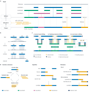

<p>
  
</p>

# CGAT — Complete Genome Assembly Toolkit

**English** | [中文](README_zh.md)

The automated assembly-repair engine is **LGZ** (**Linking Inter-assembly Units for Genome Zipping**).

[](https://riceome.hzau.edu.cn/cgat/)
[](https://github.com/Jianwei-Zhang/CGAT/releases)

**CGAT** is an integrated toolkit for chromosome-scale genome assembly, multi-assembly collinearity review, and targeted long-read sequence refinement. It connects automated processing on Linux (**GPM2.0 Server**), interactive visual curation on Windows and macOS (**GPM2.0 Desktop**), and long-read gap filling and telomere extension (**DEGAP2.0**).



---

## Toolkit Components

| Component | Platform | Role | Documentation |
| --- | --- | --- | --- |
| **GPM2.0 Server** | Linux | Aligns multiple *de novo* assemblies to a reference genome, assigns chromosomes, runs automated LGZ repair, and packages results (`Full` / `Light` archives + self-contained `report.html`). | [GPM2.0 Guide](GPM2.0/README.md) · [Server Manual](GPM2.0/server/README.md) |
| **GPM2.0 Desktop** | Windows / macOS | Imports Server delivery archives for chromosome-level source **Preview**, **Assembly** & **Subview** alignment inspection, **Final Path** editing, `DEGAP-JOBS` generation, and multi-format export. | [GPM2.0 Guide](GPM2.0/README.md#desktop-app) · [Online Docs](https://riceome.hzau.edu.cn/cgat/guide/getting-started) |
| **DEGAP2.0** | Linux | Resolves remaining assembly gaps, links contigs, and extends chromosome ends toward telomeres using HiFi and/or ONT long reads. | [DEGAP2.0 Guide](DEGAP2.0/README.md) · [Online Docs](https://riceome.hzau.edu.cn/cgat/guide/degap) |

---

## Quick Start

### 1. Run GPM2.0 Server on Linux

Download, verify, and install `GPM_Server` into `~/bin/GPM_Server` (downloads from the official mirror first and falls back to GitHub Release), then run the workflow from your project directory:

```bash
# Install GPM2.0 Server and create the isolated cgat-server environment
SERVER="$HOME/bin/GPM_Server"
(
  set -euo pipefail
  mkdir -p "$(dirname "$SERVER")" && mkdir "$SERVER" && cd "$SERVER"
  archive=GPM_Server_2.0.16_source.tar.gz
  curl -fL --connect-timeout 8 --max-time 60 -o "$archive" \
    "https://riceome.hzau.edu.cn/cgat/downloads/v2.0.16/$archive" ||
    curl -fL --connect-timeout 8 --max-time 60 -o "$archive" \
      "https://github.com/Jianwei-Zhang/CGAT/releases/download/v2.0.16/$archive"
  tar -xzf "$archive" --strip-components=1
  bash ./install.sh
)

# Activate the environment printed by the installer (e.g. micromamba / mamba / conda)
micromamba activate cgat-server

# Run alignment, LGZ repair, reporting, and delivery packaging
bash "$SERVER/run.sh" \
  --ref /path/to/reference.fa \
  --ds /path/to/primary_assembly.fa \
  --ds /path/to/auxiliary_assembly.fa \
  -o ./gpm_server \
  -t 10
```

This produces `gpm_server.tar.gz` (Full package), `gpm_server.light.tar.gz` (Light package), and `gpm_server/report/report.html`. See [GPM2.0/README.md](GPM2.0/README.md) for full options and SHA-256 verification.

### 2. Inspect and Edit in GPM2.0 Desktop (Windows / macOS)

1. Download the installer for your platform (`win-x86`, `win-arm64`, `mac-arm64`, or `mac-x86`) from [CGAT Downloads](https://riceome.hzau.edu.cn/cgat/downloads) or [GitHub Releases](https://github.com/Jianwei-Zhang/CGAT/releases).
2. Import `gpm_server.tar.gz`, `gpm_server.light.tar.gz`, or the precomputed demo package `test_data.zip`.
3. Review chromosome sources in **Preview**, inspect collinearity evidence in **Assembly** and **Subview**, edit the **Final Path**, and export PNG, TSV, LOG, or FASTA files.

### 3. Fill Gaps or Extend Telomeres with DEGAP2.0 (Optional)

Export `DEGAP-JOBS` from **GPM2.0 Desktop** for remaining gaps or chromosome ends, or run **[DEGAP2.0](DEGAP2.0/README.md)** directly on Linux (`GapFiller`, `CtgLinker`, `TelSeeker`, `TelSeeker Ctg`, or `AutoGapfiller`) with HiFi and/or ONT long reads.

---

## Documentation & Downloads

- **Documentation & Direct Downloads (No GitHub required)**: <https://riceome.hzau.edu.cn/cgat/>
- **GitHub Releases**: <https://github.com/Jianwei-Zhang/CGAT/releases>
- **GPM2.0 System Guide**: [English](GPM2.0/README.md) | [中文](GPM2.0/README_zh.md)
- **GPM2.0 Server Manual**: [English](GPM2.0/server/README.md) | [中文](GPM2.0/server/README_zh.md)
- **DEGAP2.0 User Guide**: [English](DEGAP2.0/README.md)

---

## Citations

If you use **CGAT**, **GPM2.0**, or **DEGAP2.0** in your research, please cite:

- **GPM**: Zhang, J. et al. Genome Puzzle Master (GPM): an integrated pipeline for building and editing pseudomolecules from fragmented sequences. *Bioinformatics* **32**(20), 3058–3064 (2016). <https://doi.org/10.1093/bioinformatics/btw370>
- **DEGAP**: Huang, Y. et al. DEGAP: Dynamic Elongation of a Genome Assembly Path. *Briefings in Bioinformatics* **25**(3), bbae194 (2024). <https://doi.org/10.1093/bib/bbae194>

## Contact

For questions, bug reports, or suggestions, please open an issue on [GitHub Issues](https://github.com/Jianwei-Zhang/CGAT/issues) or contact <jzhang@mail.hzau.edu.cn>.
